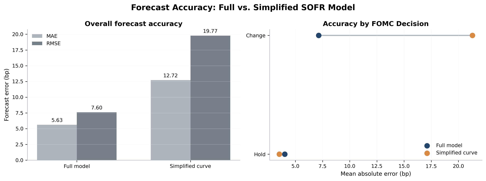
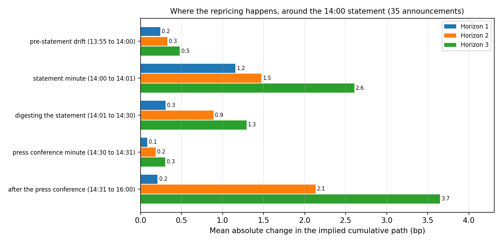

# Pricing the Fed with SOFR Futures

**How well do SOFR futures predict the path of Federal Reserve policy rates?** This repository answers that using CME data from Databento. On each date it recovers the rate change the futures market expects at every upcoming FOMC meeting, then scores those expectations against what the Fed actually did.

## What the repository does

1. **Collects** daily settlement prices for One-Month (SR1) and Three-Month (SR3) SOFR futures from Databento (`GLBX.MDP3`): 73,044 settlements across 178 contracts and 1,193 sessions, 2022-01-03 to 2026-09-30. 99.2% are final settlements, there are no duplicates or implausible prices, and every contract's expiry matches CME's own.
2. **Estimates** the market-implied Fed path on the first trading day of each month (56 dates, February 2022 to September 2026). A regularized least-squares fit finds the expected move at each upcoming meeting that best reprices the whole SR1 and SR3 strip, using each contract's exact settlement window and published SOFR for the days already elapsed ([method](docs/METHODOLOGY.md)).
3. **Scores** those paths against realized FOMC decisions one to six meetings ahead, and against a simpler smooth SOFR curve that ignores meeting dates.
4. **Studies the announcement itself**: one-minute SR1 and SR3 bars from Databento around 35 FOMC statements show how fast the implied path moves when the Fed speaks.

## What we found

**Next-meeting forecasts are accurate. Long-horizon forecasts are not.**

| Meetings ahead | 1 | 2 | 3 | 4 | 5 | 6 |
| --- | ---: | ---: | ---: | ---: | ---: | ---: |
| Mean absolute error (bp) | 5.6 | 14.1 | 28.6 | 41.5 | 53.3 | 63.5 |
| Bias (bp) | 0.0 | −6.0 | −17.0 | −30.1 | −42.8 | −53.6 |

The direction of the next move is right on 98% of forecasts. Most of the long-horizon error is the 2022 hiking cycle, which the market kept underpricing: four meetings ahead the error is 89 bp for 2022 forecasts and 28 bp for 2023 to 2026. Futures prices include risk premia, so these are market-implied expectations, not pure forecasts.

**Modeling the meeting calendar helps, when the Fed moves.** Against a smooth curve that ignores meeting dates, the FOMC-aware fit cuts the next-meeting error from 12.7 bp to 5.6 bp. Averaged by meeting, the gain is at meetings that changed rates (7.4 versus 22.9 bp; a 15.5 bp gap, 95% interval 9.1 to 23.3, over 18 meetings). On the 19 holds the two are indistinguishable (4.3 versus 3.7 bp). The advantage holds in every year, and it is not extra SR3 information: an SR1-only fit gives the same 5.6 bp.



**Intraday, today's meeting reprices in the first minute.** Across 35 FOMC afternoons the path for the meeting being announced moves 1.2 bp on average (absolute) in the statement minute, 0.3 bp over the next 29 minutes and 0.1 bp in the press-conference minute. Meetings two and three ahead move 1.5 and 2.6 bp in the statement minute and a further 2.1 and 3.7 bp after the press conference. The largest surprise was 18 September 2024: the 13:55 book priced a 37 bp cut and the Fed delivered 50 bp (12.8 bp of news). On 25 of the 29 usable afternoons the repricing is under 2 bp.



## What we could not conclude

- **The daily bootstrap is fragile.** A simpler exact solve, used for the daily SR1 comparison, divides by the days left in the month after a meeting, so a meeting in the last days of a month turns a small price error into a large one. It has a lower average error than the smooth curve (11.2 versus 13.1 bp) but the same RMSE (20.6 versus 20.4 bp), and it loses on holds (12.5 versus 2.0 bp). The regularized fit above does not have this problem ([details](CURVE_COMPARE.md)).
- **Some intraday afternoons are not usable.** The fit must close on the announced move (mean miss 1.0 bp). Six afternoons are flagged: four are one rank short of a unique answer, and two miss the announced move by more than 2 bp. One of those, 29 October 2025, is a SOFR funding squeeze misread as a hawkish surprise because the basis is held fixed. Flagged days are kept in the tables but not reported as news.
- **Coverage.** Three of the 38 announcements (June to September 2026) cannot be studied intraday because their contract strip reaches 2027 meetings that are not yet in the calendar.
- **Licence.** Databento data cannot be redistributed, so raw prices are not in the repository. Derived tables and figures are. Everything regenerates from the commands below.

## Reproduce the results

Requirements: Python 3.12 or newer, and a Databento API key (the course provides one). On the course account Databento quoted $0.0000 for both downloads. The offline test suite passes on a fresh install (pandas 3.1, NumPy 2.5) and on pandas 2.3.

```bash
pip install -r requirements.txt
printf '%s' 'db-YOUR_KEY_HERE' > ~/.databento_api_key && chmod 600 ~/.databento_api_key

python scripts/reproduce.py --dry-run   # quotes the Databento cost; downloads nothing
python scripts/reproduce.py --yes       # runs every step below, in order
```

The first run downloads SR1 and SR3 data for 2022 to September 2026 and takes a while. Databento sometimes answers with a timeout, so every request retries automatically and is cached: an interrupted run resumes where it stopped, and nothing is downloaded twice. `python scripts/reproduce.py --list` shows the plan, and `--only NAME` or `--skip NAME` selects steps.

| Step | Produces | Data |
| --- | --- | --- |
| `sofr_futures` | cleaned settlement panel, data quality report ([DATA.md](DATA.md)) | **Databento** |
| `rate_data` | daily SOFR and EFFR, FOMC decisions ([FED_RATE_DATA.md](FED_RATE_DATA.md)) | NY Fed, FRED |
| `alignment` | each settlement matched to the meetings it can forecast | derived |
| `historical_forecasts` | monthly market-implied paths | derived |
| `forecast_errors` | errors by horizon ([FORECAST_EVAL.md](FORECAST_EVAL.md)) | derived |
| `curve_comparison`, `daily_sr1_comparison` | full model versus smooth curve ([CURVE_COMPARE.md](CURVE_COMPARE.md)) | derived |
| `final_figures` | the four figures in `reports/results/` ([VISUALIZATIONS.md](final_visualizations/VISUALIZATIONS.md)) | derived |
| `minute_bars` | one-minute bars around each statement | **Databento** |
| `intraday_study` | `reports/intraday/real/` ([INTRADAY.md](INTRADAY.md)) | derived |

To check the setup without any data, `python -m pytest tests -q` runs offline and needs no key.

## Repository layout

| Path | Contents |
| --- | --- |
| `sofr_data/` | Databento download, cleaning, contract conventions, quality checks, retries |
| `fomc_data/` | FOMC calendar, realized decisions, NY Fed and FRED rates, futures alignment |
| `sofr_pricing/` | SR1 and SR3 pricing and the implied-path estimator |
| `forecast_eval/` | Forecast error, bias and hit-rate scoring |
| `curve_compare/` | The smooth-curve baseline and the daily SR1 comparison |
| `final_visualizations/` | The four report figures |
| `fomc_intraday/` | The intraday event study and its closing check |
| `scripts/` | One script per step; `reproduce.py` runs them in order |
| `reports/` | Committed results: figures, tables, data quality report |
| `docs/METHODOLOGY.md` | Derivation, assumptions and limitations |

Raw and processed data are written to `data/` and are not committed.

## Team

| Member | Role | Issues |
| --- | --- | --- |
| Maisha Miah | Tech Leader | [#1](https://github.com/mmiah00/FINM37000-group6-project/issues/1) Databento data and repository setup |
| Ivy Chan | Communication Leader | [#2](https://github.com/mmiah00/FINM37000-group6-project/issues/2), [#7](https://github.com/mmiah00/FINM37000-group6-project/issues/7) |
| Theo Li | Design Leader | [#3](https://github.com/mmiah00/FINM37000-group6-project/issues/3), [#4](https://github.com/mmiah00/FINM37000-group6-project/issues/4) |
| Sankalp Yadav | Design Leader | [#5](https://github.com/mmiah00/FINM37000-group6-project/issues/5), [#6](https://github.com/mmiah00/FINM37000-group6-project/issues/6); the optional intraday study ([#8](https://github.com/mmiah00/FINM37000-group6-project/issues/8)) is in PR #25 |
